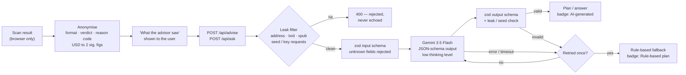
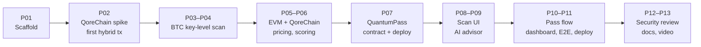

# AI usage — Shor's Reach

> **AI explains, the chain proves.** In Shor's Reach every verdict comes from deterministic code backed by an on-chain transaction. AI does what it is best at: turning a complex risk picture into a calm, ordered plan a normal holder can act on. It never sees an address, never decides a verdict, and never leaves the user without an answer.

Shor's Reach applies for the **Best AI-Native Build** award. This document covers the two sides of that claim:

1. **AI inside the product:** the advisor and the "Ask about your plan" Q&A, and the engineering choices that make them safe, fast and cheap.
2. **AI-native engineering:** how AI built the product through a gated, verification-first process, and where humans stayed in charge.

---

## Contents

- [Design principles](#design-principles)
- [1. AI inside the product](#1-ai-inside-the-product)
  - [Pipeline](#pipeline)
  - [Advisor at a glance](#advisor-at-a-glance)
  - [Privacy by construction](#privacy-by-construction)
  - [Optimisations](#optimisations)
  - [Guardrails](#guardrails)
  - [Failure modes and how each is handled](#failure-modes-and-how-each-is-handled)
  - [What the AI is deliberately not allowed to do](#what-the-ai-is-deliberately-not-allowed-to-do)
- [2. AI-native engineering](#2-ai-native-engineering)
  - [The gated build plan](#the-gated-build-plan)
  - [Verify, don't trust](#verify-dont-trust)
  - [When reality disagreed with the plan](#when-reality-disagreed-with-the-plan)
  - [Division of labour](#division-of-labour)
- [Evidence index](#evidence-index)

---

## Design principles

| Principle | What it means in the code |
|---|---|
| **Deterministic core, generative edge** | The scan engine (verdicts, evidence, score) is pure, tested TypeScript. AI only sits at the edge, where language matters: explaining and prioritising. |
| **Privacy by construction, not by policy** | The model physically cannot receive an address: the summary is built without identifiers, and a server-side filter rejects anything that looks like one before parsing. |
| **Structured in, structured out** | Both directions are JSON schemas validated with zod. No free-text parsing, no prompt-shaped surprises in the UI. |
| **Graceful degradation** | No key, API down, slow or invalid answer → a deterministic rule-based plan from the same summary. The user always gets a plan. |
| **Show your work** | The page shows the exact JSON the advisor saw, and a badge says whether a plan is **AI-generated** or **Rule-based**. |

---

## 1. AI inside the product

### Pipeline

### Advisor at a glance

| | |
|---|---|
| **Surfaces** | `/plan` page → `POST /api/advise` (plan) and `POST /api/ask` (follow-up Q&A) |
| **Code** | [`app/src/advisor/`](app/src/advisor/) — `prompt.ts`, `schema.ts`, `server.ts`, `ask.ts`, `fallback.ts`; endpoints in [`app/api/advise.ts`](app/api/advise.ts), [`app/api/ask.ts`](app/api/ask.ts) |
| **Model** | Google Gemini `gemini-3.5-flash`, low thinking level; override with `ADVISOR_MODEL` |
| **Input** | An anonymised summary only: chain, address format, verdict, reason code, USD rounded to 2 significant figures, questionnaire answers, QoreChain key/window flags |
| **Output** | Structured JSON: summary, prioritised actions (each with *why* and *how*), what to stop doing, open unknowns, QoreChain note |
| **Q&A** | "Why is my Taproot address red?", "What do I do with a Ledger?" — answered from the same anonymised summary, with rule-based answers if the model is down |
| **Logging** | Token counts and stop reason only. Payloads are never logged. |

### Privacy by construction

The advisor is useful **because** it knows little. A remediation plan depends on *what kind* of exposure you have (format, verdict, rough size), not on *which* address it is. So the summary contains exactly that and nothing more:

| Sent to the model | Never sent |
|---|---|
| Chain and address format (e.g. "P2PKH, Bitcoin") | Addresses, public keys, xpubs |
| Verdict + reason code | Transaction IDs |
| USD value rounded to 2 significant figures | Exact balances |
| Questionnaire answers (e.g. hardware wallet: yes) | Anything typed that looks like a seed or key |
| QoreChain flags (PQ key registered, EVM window open) | IP-linked history — no payload logging |

Two layers enforce it: the browser builds the summary without identifiers, and the server's leak filter rejects any request that still contains one, without echoing it back in the error.

### Optimisations

Every choice below was made to keep the advisor **fast, cheap, reliable and private** at the same time.

| Optimisation | Why |
|---|---|
| **Flash model + low thinking level** | The plan is explanation, not research. A small, fast model with low reasoning effort answers in a few seconds at a fraction of the cost, and the quality is set by the structured summary rather than by model size. |
| **Native JSON-schema output** | The model is constrained to the exact response shape. No regex parsing, almost no malformed answers, and the UI renders actions directly. |
| **Compact input** | Rounded numbers and reason codes instead of raw scan data keep prompts small — lower cost, lower latency, and nothing sensitive to leak. |
| **Key rotation** | `GEMINI_API_KEYS` takes several keys; on 401 / 403 / 429 the client moves to the next one, so one rate-limited key doesn't take the feature down. |
| **Model fallback chain** | If `gemini-3.5-flash` is overloaded (503), missing or slower than 15 s, the request moves to `gemini-3.5-flash-lite`, then `gemini-3-flash-preview` (configurable with `ADVISOR_FALLBACK_MODELS`). Found and fixed in production during a Google capacity spike: every request still got an AI answer. |
| **Hard time budget** | The whole AI call has a 45 s budget inside Vercel's 60 s limit, so the server always has time to return the rule-based plan instead of a timeout. |
| **One retry, then fallback** | A single retry absorbs transient failures; beyond that the user gets the rule-based plan immediately instead of waiting. |
| **Per-call timeout + rate limit + 32 KB body cap** | Bounded cost per request and protection against abuse of a public endpoint. |
| **Shared summary for plan and Q&A** | Follow-up questions reuse the same anonymised summary — no new data collection, consistent answers. |
| **Works without AI** | Static hosting or no keys → the full app still works with the rule-based plan, so judges and users are never blocked. |

### Guardrails

| Layer | Rule |
|---|---|
| **Input** | Strict zod schema (unknown fields rejected); leak filter for Bitcoin / EVM / QoreChain addresses, txids and xpubs **before** parsing; questions that contain addresses or seed phrases are refused before any model call |
| **System prompt** ([`prompt.ts`](app/src/advisor/prompt.ts)) | No Q-Day date predictions · never ask for seeds or keys · not financial advice, no token promotion · QoreChain described factually · Bitcoin / EVM migration guidance grounded in the scanner's rules |
| **Output** | Rejected (→ retry once → fallback) if invalid, truncated, refused, contains an identifier, or asks the user to share or enter a seed or key |
| **Transport** | Per-IP rate limit, body size cap, timeout |

### Failure modes and how each is handled

| What goes wrong | What the user sees |
|---|---|
| No API key configured / static hosting | Rule-based plan, labelled as such |
| Gemini returns 401 / 403 / 429 | Next key in the rotation; if all fail → rule-based plan |
| Model overloaded (503) or slow | Next model in the fallback chain, within the 45 s budget |
| Timeout or network error | Next model; if the budget runs out → rule-based plan |
| Malformed or truncated JSON | Rejected by zod → retry → rule-based plan |
| Model refuses | Rule-based plan |
| Model output contains an identifier or asks for a seed | Rejected → retry → rule-based plan |
| User pastes an address or seed into a question | Refused before any model call, with a clear message |

### What the AI is deliberately not allowed to do

- **Decide a verdict.** Exposure comes from the deterministic engine, with a linked transaction as evidence. The AI only explains and prioritises.
- **Predict a date.** Nobody knows when Q-Day arrives; the product shows exposure, not a countdown.
- **Touch keys or funds.** It never asks for a seed or private key and never signs or moves anything.
- **Promote tokens** or give financial advice.

### Tests

[`app/src/advisor/advisor.test.ts`](app/src/advisor/advisor.test.ts) and [`ask.test.ts`](app/src/advisor/ask.test.ts) cover: schema validation, leak rejection (address / txid), the fallback for 3 fixture summaries, a mocked API (retry, refusal, leaky output), and HTTP 400 / 405 / 429. Live checks: `npm run advise:live` and `npm run ask:live` ([`advise-live.ts`](app/scripts/advise-live.ts), [`ask-live.ts`](app/scripts/ask-live.ts)), plus the 5-persona production workflow run ([report](docs/reports/workflows-production.md), 35/35).

---

## 2. AI-native engineering

Shor's Reach was built AI-first with **Claude Code** as the coding agent, but not by "prompting until it works". The process was designed so that AI speed never outran evidence.

### The gated build plan

The whole build was written down first as **13 prompts** ([`docs/prompts/P01…P13`](docs/prompts/)), each with a scope, a deliverable and a **validation gate** that had to pass before the next one started.

| Gate type | Example |
|---|---|
| **Automated tests** | Scan engine on recorded mainnet fixtures incl. BIP-84 test vectors; 18 Foundry tests with fuzzing and attack cases |
| **Live on-chain checks** | Real hybrid ML-DSA-87 transactions and a real on-chain ML-DSA-87 mint on qorechain-diana before the UI was built on top |
| **Human review items (👤)** | Trust model, testnet deploys, copy, visual QA |

Progress and evidence for every gate: [`docs/prompts/PROGRESS.md`](docs/prompts/PROGRESS.md).

**Why this works:** the riskiest unknown — can a contract really verify ML-DSA-87 on QoreChain? — was tested in **P02**, on day one, before any UI existed. Everything after it was built on a proven foundation.

### Verify, don't trust

AI-generated code was treated as a hypothesis until proven:

- **On-chain claims were tested live**, not assumed. Verifying ML-DSA-87 inside `QuantumPass` with a real signature on testnet is how we found an **ABI bug in the QoreChain SDK's `pqcKeyStatus` definition** ([`docs/architecture/spikes.md`](docs/architecture/spikes.md)).
- **Verdicts were checked against block explorers** on recorded mainnet data before they were frozen as test fixtures.
- **A real-browser workflow suite** drives 5 user personas through the production site against live chains and the live model ([report](docs/reports/workflows-production.md)).
- **A security review and audit pass** hardened every endpoint, added security headers and a clickjacking guard ([`docs/SECURITY_REVIEW.md`](docs/SECURITY_REVIEW.md), [`docs/AUDIT.md`](docs/AUDIT.md)).
- **A benchmark** compares the scanner with other quantum-exposure tools, using only their public claims ([`docs/BENCHMARK.md`](docs/BENCHMARK.md)).

### When reality disagreed with the plan

The original AI-proposed design had the wallet sign an ML-DSA-87 digest for the contract. The P02 spike showed **QoreX 0.3.x cannot sign EVM transactions or arbitrary messages**. Instead of forcing it, the plan changed: the pass gained a second door, `attest()`, where the proof is a hybrid-signed **native** transaction that the chain itself only accepts from a registered post-quantum key. The fully on-chain `mint()` path stayed, ready for when wallets catch up. Documented in [`docs/architecture/spikes.md`](docs/architecture/spikes.md).

### Division of labour

| Part | AI share | Human role |
|---|---|---|
| Scan engine, tests, fixture recorder | ~95 % | Chose the rules and data sources; checked verdicts against block explorers |
| UI pages and styles | ~95 % | Design direction (12 reference sites), copy review, visual QA |
| Contract + Foundry tests | ~95 % | Reviewed the trust model (self-mint vs attest); approved testnet deploys |
| Advisor (prompt, schemas, guardrails) | ~95 % | Set the rules: no dates, no shilling, never ask for keys; read the generated plans |
| Research, architecture, docs | ~90 % | Idea selection, scope cuts, final wording |

**Humans owned every decision that matters:** what to build, what to cut, the trust model, every deploy, and every secret. No mnemonic or API key was ever committed — they live in gitignored `.env` files and Vercel environment variables. The starting point is the untouched `create-qorechain-dapp` scaffold (first commit [`bd58dbf`](https://github.com/rohan911438/Shors-Reach/commit/bd58dbf)).

---

## Evidence index

| Claim | Where to check |
|---|---|
| Advisor code, prompt, schemas, fallback | [`app/src/advisor/`](app/src/advisor/) |
| Advisor and Q&A tests | [`advisor.test.ts`](app/src/advisor/advisor.test.ts), [`ask.test.ts`](app/src/advisor/ask.test.ts) |
| Live production workflows (35/35) | [`docs/reports/workflows-production.md`](docs/reports/workflows-production.md) |
| Build plan and gate evidence | [`docs/prompts/`](docs/prompts/), [`PROGRESS.md`](docs/prompts/PROGRESS.md) |
| Spikes, SDK bug, design change | [`docs/architecture/spikes.md`](docs/architecture/spikes.md) |
| AI advisor architecture | [`docs/architecture/06-ai-advisor.md`](docs/architecture/06-ai-advisor.md) |
| Security review and audit | [`docs/SECURITY_REVIEW.md`](docs/SECURITY_REVIEW.md), [`docs/AUDIT.md`](docs/AUDIT.md) |
| On-chain deployments and transactions | [`deployments/diana.json`](deployments/diana.json) |
| Try it live | [shors-reach.vercel.app/#/plan](https://shors-reach.vercel.app/#/plan) |
