<div align="center">

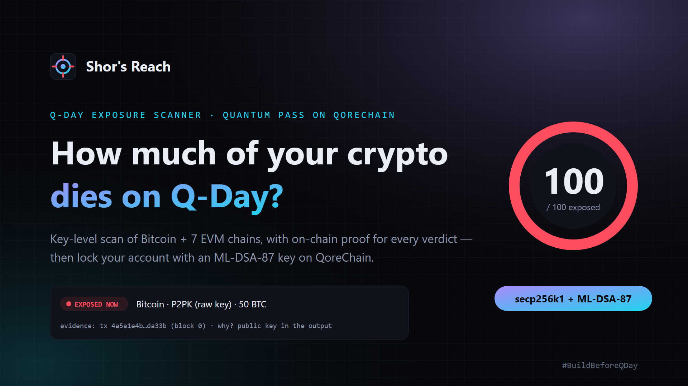

# Shor's Reach

### Find every coin a quantum computer could steal from you — then lock your QoreChain account with a post-quantum key.

**Key-level quantum-exposure scanner for Bitcoin, 7 EVM chains and QoreChain · AI remediation plan · soulbound Quantum Pass verified with ML-DSA-87 on-chain**

[](https://build.qorechain.io/p/shor-s-reach)
[](https://github.com/rohan911438/Shors-Reach/actions/workflows/ci.yml)
[](LICENSE)
[](https://shors-reach.vercel.app)
[](https://youtu.be/4W-PkwzndHk)
[](https://explore.qore.network/address/0x4f54b69693458523223504b48fa7cd44657a56df)
[](#how-the-quantum-pass-works)

[**Project page**](https://build.qorechain.io/p/shor-s-reach) · [**Live demo**](https://shors-reach.vercel.app) · [**Demo video**](https://youtu.be/4W-PkwzndHk) · [**Contract**](https://explore.qore.network/address/0x4f54b69693458523223504b48fa7cd44657a56df) · [**Scan API docs**](https://shors-reach.vercel.app/#/developers) · [**Methodology**](https://shors-reach.vercel.app/#/methodology) · [**Telegram bot**](https://t.me/ShorsReachBot)

*Entry for the **QoreChain Developer Fest — "Build Before Q-Day"** · Main track: **Quantum Pass** · Awards: **Best AI-Native Build** · **People's Choice** · **Quantum Campus** · **Regional (India · Asia-Pacific)***

</div>

---

## Tracks and awards

Shor's Reach is entered in **one main track** and applies for **every special award it qualifies for**. Each one below lists what it asks for and where to find the proof.

| # | Track / award | Type | Status | Why we fit |
|---|---|---|---|---|
| 1 | 🎖️ **Quantum Pass** | Main track | ✅ Entered — all requirements met | "PQC checker" is a named example in the brief, and the *pass* is literally what we mint |
| 2 | 🤖 **Best AI-Native Build** | Special award | ✅ Applied — AI-Native verified on the project page | AI is a core feature, not decoration; the build process is documented in [AI_USAGE.md](AI_USAGE.md) |
| 3 | 📣 **People's Choice** | Special award | ✅ Applied | A personal "$X exposed" result and an address-free share card make it naturally shareable |
| 4 | 🎓 **Quantum Campus** | Special award | ✅ Applied | Every team member is a student |
| 5 | 🌏 **Regional Award** | Special award | ✅ Applied — India · Asia-Pacific | Team region |
| 6 | 🏅 **Top-Quality Award** / Quantum Pass raffle | Automatic | ✅ Eligible | Every submission check passed; tests, CI, live demo |

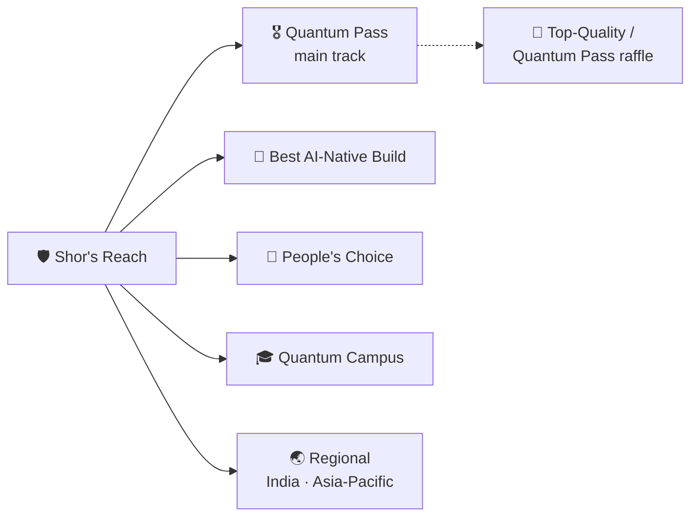

### 1. 🎖️ Quantum Pass — main track

> *"Build a small original QoreChain app, tool, game or bot. Use create-qorechain-dapp, connect QoreX, deploy on testnet and complete one hybrid-signed transaction."*

| Requirement | How | Proof |
|---|---|---|
| Use `create-qorechain-dapp` | `app/` = `viem-wagmi` template, `contracts/` = `foundry` template | First commit [`bd58dbf`](https://github.com/rohan911438/Shors-Reach/commit/bd58dbf) is the untouched scaffold |
| Connect QoreX | RainbowKit `qorexWallet` (EVM lane) + `window.qorex.native` (`enable` / `getKey` / `signAndBroadcast`) for the pass | [`app/src/wagmi.ts`](app/src/wagmi.ts), [`app/src/pass/qorex.ts`](app/src/pass/qorex.ts) |
| Deploy on testnet | `QuantumPass` on qorechain-diana (EVM 9800) | [`0x4f54b696…a56df`](https://explore.qore.network/address/0x4f54b69693458523223504b48fa7cd44657a56df) — [`deployments/diana.json`](deployments/diana.json) |
| Hybrid-signed transaction | Native txs carry `/qorechain.pqc.v1.PQCHybridSignature` (secp256k1 + ML-DSA-87) | EVM window `82CAAC03…1104`, `C584F991…3972`; pass proof `926E749D…E55F` |
| On-chain PQ verification | `mint()` verifies ML-DSA-87 with `pqcVerify` (0x0a01) against the key from `pqcKeyStatus` (0x0a02) | Self-mint `0xb6ac662a…a38d` |

**Beyond the minimum:** the pass goes further than one hybrid transaction. It is soulbound, bound to the hash of the registered ML-DSA-87 key, and can be minted with the signature verified **fully on-chain** through the `pqcVerify` / `pqcKeyStatus` precompiles. Verified on the project page: QoreChain SDK, QoreX integrations, hybrid ML-DSA-87 transactions, PQC key registration with proof of possession, EVM window.

Track mapping in detail: [docs/tracks/01-quantum-pass-main-track.md](docs/tracks/01-quantum-pass-main-track.md)

### 2. 🤖 Best AI-Native Build

> *Built with AI tools, documented in an `AI_USAGE.md` file in the repo.*

| What judges look for | Shor's Reach |
|---|---|
| AI in the product, not just the pitch | The **AI advisor** turns a multi-chain exposure report into a calm, prioritised plan, and **Ask about your plan** answers follow-up questions — both live at [#/plan](https://shors-reach.vercel.app/#/plan) |
| Responsible AI | Anonymised input only (no addresses, txids, xpubs or exact amounts), leak filters both ways, never asks for seeds or keys, no date predictions, users see exactly what was sent |
| Engineered, not bolted on | JSON-schema output validated with zod, low-latency Flash model, key rotation, one retry then a deterministic rule-based fallback — the user always gets a plan |
| AI-native build process | 13 gated prompts with validation gates ([docs/prompts](docs/prompts)), live on-chain verification, progress log ([PROGRESS.md](docs/prompts/PROGRESS.md)) |
| Documentation | [AI_USAGE.md](AI_USAGE.md) — principles, pipeline, optimisations, failure modes, division of labour, evidence index |

### 3. 📣 People's Choice

| Built for sharing | Details |
|---|---|
| A result people want to post | Every scan ends in a headline: how much of your crypto is exposed now, in BTC and USD |
| Share card | 1200×675 image with the score and buckets — **no addresses** — ready for X with **#BuildBeforeQDay** |
| Public counter | [Dashboard](https://shors-reach.vercel.app/#/dashboard): passes minted, attested exposure buckets, chains |
| Zero friction | No sign-up, no wallet needed to scan; one link: [shors-reach.vercel.app](https://shors-reach.vercel.app) |

**Vote:** open the [project page](https://build.qorechain.io/p/shor-s-reach) during the voting window and support Shor's Reach with QoreX.

### 4. 🎓 Quantum Campus

Built by a student team, start to finish. Proof of enrolment is provided to the organisers as the rules require.

### 5. 🌏 Regional Award — India · Asia-Pacific

Built in **India** for the **Asia-Pacific** region. Quantum risk is global — the scanner covers Bitcoin, 7 EVM chains and QoreChain, works in any browser, and needs no account.

### 6. 🏅 Automatic eligibility

Every submission check is designed to pass: public MIT repo, video ≤ 3 min, live demo, testnet contract and hybrid transactions, verified kits. That keeps Shor's Reach eligible for the **Quantum Pass raffle** and the **Top-Quality Award** (both are fallbacks for passing projects that don't win a jury prize; Regional works the same way).

All awards in detail: [docs/tracks/02-side-awards.md](docs/tracks/02-side-awards.md)

---

## Table of contents

1. [Tracks and awards](#tracks-and-awards)
2. [TL;DR](#tldr)
3. [The problem](#the-problem)
4. [The solution](#the-solution)
5. [Try it in 30 seconds](#try-it-in-30-seconds)
6. [Features](#features)
7. [System architecture](#system-architecture)
8. [User workflow](#user-workflow)
9. [How the scan engine works](#how-the-scan-engine-works)
10. [How the Quantum Pass works](#how-the-quantum-pass-works)
11. [AI advisor pipeline](#ai-advisor-pipeline)
12. [Privacy model](#privacy-model)
13. [On-chain deployments and transactions](#on-chain-deployments-and-transactions)
14. [Tech stack](#tech-stack)
15. [Repository layout](#repository-layout)
16. [Run locally](#run-locally)
17. [Testing and quality](#testing-and-quality)
18. [Scan API and widget](#scan-api-and-widget)
19. [Documentation index](#documentation-index)
20. [All links](#all-links)
21. [Licence](#licence)

---

## TL;DR

| | |
|---|---|
| **Who it's for** | Anyone holding BTC / ETH / EVM assets, plus wallets, exchanges and custodians that want to warn their users |
| **What it answers** | *"Which of my coins could a quantum computer attack today, how much are they worth, and what do I do about it?"* |
| **What's new** | Exposure is checked **per key, not per address**: 7 Bitcoin address forms, raw P2PK outputs, xpubs, 7 EVM chains and QoreChain — and every red verdict links to the transaction that proves it |
| **On-chain part** | A soulbound **Quantum Pass** on QoreChain that can only be minted by an account protected by a registered **ML-DSA-87** post-quantum key, verified by the chain's PQC precompiles |
| **AI part** | Google Gemini turns an **anonymised** summary into a calm, prioritised plan and answers follow-up questions; rule-based fallback when the model is down |

---

## The problem

> **Quantum computers won't break Bitcoin by guessing passwords. They'll break it by reading public keys that are already on the blockchain.**

Shor's algorithm lets a large enough quantum computer derive a private key from its **public key**. Most coins are safe until their owner spends, because only a hash of the key is on-chain. But a huge amount of value has already had its public key revealed.

| Pain point | Why it matters |
|---|---|
| **~6.3M BTC (~31% of supply) sits behind public keys already on-chain** | These "long-exposure" coins can be attacked at leisure once a capable machine exists (Glassnode, Oct 2026; Project Eleven's tracker says ~6.9M). Sources: [docs/research/03](docs/research/03-quantum-threat-research.md) |
| **Holders can't see their own exposure** | Address checkers look at one address. But exposure belongs to the **key** — the same key lives in 7 Bitcoin address forms, on every EVM chain, and in Satoshi-era P2PK outputs that have no address at all |
| **Reused keys leak across chains** | One spend on Polygon reveals the public key for the same address on Ethereum, Base, Arbitrum… |
| **No fix exists on their chains yet** | BIP-360 is still a draft; Ethereum's post-quantum accounts are targeted for ~2029 |
| **Even QoreChain users can be exposed** | QoreChain requires hybrid secp256k1 + ML-DSA-87 signatures on native transactions **today** — but an account that never registered its PQ key, or that keeps an EVM window open, is still reachable by ECDSA |

---

## The solution

Shor's Reach is a **diagnose → plan → protect** loop:

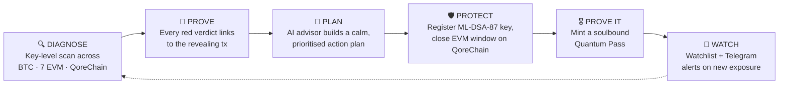

1. **See it like an attacker.** Paste a Bitcoin address, public key or xpub, any `0x…` address, or a `qor1…` address. The engine derives every sibling form of the key and checks all of them.
2. **Trust the verdict.** Each holding is classed *Exposed now*, *Exposed on spend*, *PQ-protected* or *Unknown*, with its value in BTC and USD. No evidence → never red.
3. **Know what to do.** An AI advisor gives a short, ordered plan ("move these coins first, to this kind of address"), and you can ask follow-up questions.
4. **Fix what can be fixed today.** On QoreChain, register an ML-DSA-87 key and close open EVM windows.
5. **Prove it on-chain.** Mint a soulbound **Quantum Pass**, bound to your registered post-quantum key and verified by the chain itself.

---

## Try it in 30 seconds

| Try this | What you'll see |
|---|---|
| [Satoshi's genesis public key](https://shors-reach.vercel.app/#/scan/04678afdb0fe5548271967f1a67130b7105cd6a828e03909a67962e0ea1f61deb649f6bc3f4cef38c4f35504e51ec112de5c384df7ba0b8d578a4c702b6bf11d5f) | Raw P2PK coins found by script hash — exposure an address checker cannot see |
| [vitalik.eth's address](https://shors-reach.vercel.app/#/scan/0xd8dA6BF26964aF9D7eEd9e03E53415D37aA96045) | Cross-chain EVM exposure: one revealed key, many chains |
| [Quantum Pass](https://shors-reach.vercel.app/#/pass) | The 4-step stepper: connect QoreX → register PQ key → close EVM window → mint |
| [Public dashboard](https://shors-reach.vercel.app/#/dashboard) | Passes minted, attested exposure buckets, chains — no addresses |
| [Developers](https://shors-reach.vercel.app/#/developers) | Scan API docs with a live playground and the embeddable widget |

---

## Features

| # | Feature | Details |
|---|---|---|
| 1 | **Key-level exposure scan** | Bitcoin address / public key / xpub, any `0x…` (7 EVM chains) or `qor1…`. Derives all 7 sibling forms of each key (P2PK c/u, P2PKH c/u, P2WPKH, P2SH-P2WPKH, BIP-86 Taproot), finds raw-key outputs by script hash, applies the cross-chain EVM rule, Safe owners and EIP-7702. Runs **in the browser** |
| 2 | **Evidence for every red row** | Each *Exposed now* verdict links to the transaction that revealed the key. No evidence → downgraded to *Unknown* (engine invariant, tested) |
| 3 | **BTC + USD exposure** | Every holding priced in its native coin and in USD; headline score = share of priced value that is exposed now |
| 4 | **AI advisor** | Google Gemini (`gemini-3.5-flash`) turns an anonymised summary into a prioritised plan; deterministic rule-based fallback; you can see exactly what was sent |
| 5 | **Ask about your plan** | Follow-up Q&A ("why is my Taproot address red?", "what do I do with a Ledger?"); questions containing addresses or seed phrases are refused **before** any model call |
| 6 | **QoreChain account check** | Is an ML-DSA-87 key registered? Is an EVM window open, and what's the most an attacker could move if ECDSA broke tomorrow? |
| 7 | **Quantum Pass** | Soulbound (ERC-5192) pass, minted only for accounts protected by a registered ML-DSA-87 key, bound on-chain to that key |
| 8 | **Public counter + share card** | Passes, attested exposure buckets, chains; a 1200×675 share card with no addresses |
| 9 | **Watchlist + Telegram alerts** | Saved on your device; each visit re-scans and flags a newly revealed key, new funds on an exposed key, a rising score, or funds moved to safety. Alerts via [@ShorsReachBot](https://t.me/ShorsReachBot): daily checks, `/list`, `/stop` deletes everything |
| 10 | **Scan API + embeddable widget** | `POST /api/v1/scan` for wallets, exchanges and custodians; a two-line `<script>` widget that scans in the visitor's browser |

---

## System architecture

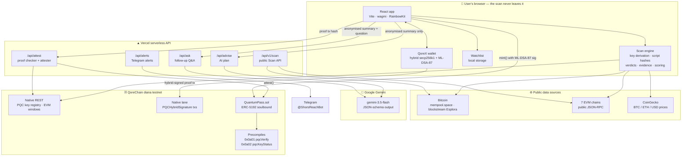

**Design principles**

- **Client-first.** The scan engine is a pure TypeScript library that runs in the browser; the scanned input lives only in the URL fragment (`#/scan/…`), which browsers never send to a server.
- **Evidence or nothing.** A red verdict without a revealing transaction is a bug; the engine downgrades it to *Unknown*.
- **Fail closed.** If an RPC rate-limits or times out, the result is *Unknown*, never *safe*.
- **Minimal trust on-chain.** The direct `mint()` path is fully on-chain; the QoreX `attest()` path trusts one attester only to check the native proof — the registry check and single-use proof are enforced by the contract.

More: [docs/architecture/01-overview.md](docs/architecture/01-overview.md) · [04-qorechain-integration.md](docs/architecture/04-qorechain-integration.md) · [05-frontend.md](docs/architecture/05-frontend.md)

---

## User workflow

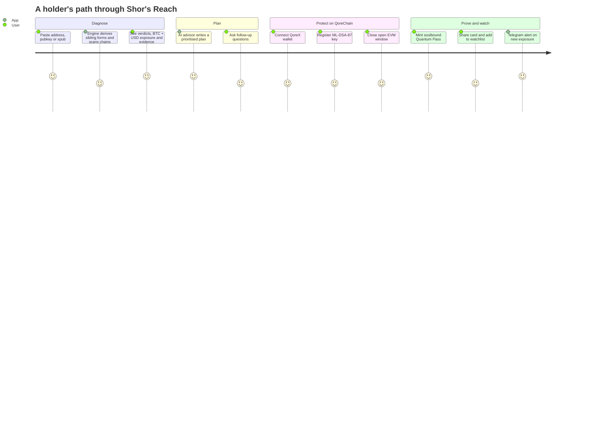

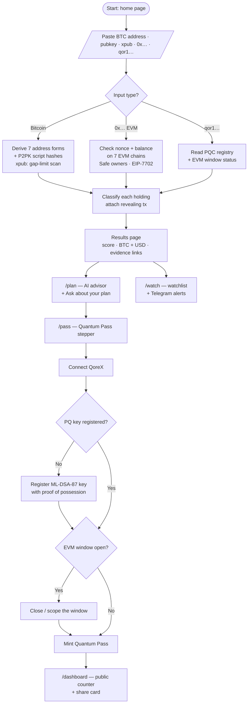

User flows in depth: [docs/idea/04-user-flows.md](docs/idea/04-user-flows.md)

---

## How the scan engine works

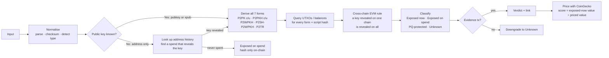

| Status | Meaning | Colour |
|---|---|---|
| **Exposed now** | The public key is on-chain. An attacker can work on it at leisure. | 🔴 |
| **Exposed on spend** | Only a hash is on-chain; the key is revealed the moment you spend — a short attack window. | 🟠 |
| **PQ-protected** | Moving it needs a post-quantum signature. Breaking ECDSA alone does nothing. | 🟢 |
| **Unknown** | No evidence either way, or a data source failed. Never shown as safe. | ⚪ |

Full rules and reason codes: [docs/architecture/02-scan-engine.md](docs/architecture/02-scan-engine.md) and the in-app [Methodology page](https://shors-reach.vercel.app/#/methodology).

---

## How the Quantum Pass works

QoreX (0.3.x) signs **native** QoreChain transactions — always with the ML-DSA-87 layer — but not EVM transactions or arbitrary messages yet. So the pass has **two doors**, both ending in the same soulbound token:

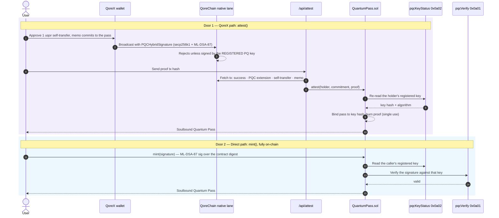

**Contract properties** ([`contracts/src/QuantumPass.sol`](contracts/src/QuantumPass.sol))

- **Soulbound** — ERC-5192 `locked()`; every transfer and approve path reverts.
- **One per account**, bound to the hash of the registered ML-DSA-87 key.
- **Privacy** — stores no addresses or amounts, only three coarse exposure buckets and a salted scan hash.
- **Replay-safe** — each proof can be used once; the attester address is immutable.

More: [docs/architecture/03-contracts.md](docs/architecture/03-contracts.md)

---

## AI advisor pipeline

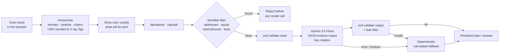

How AI runs **inside** the product and how it was used to **build** it through a gated, verification-first 13-step plan: [AI_USAGE.md](AI_USAGE.md) · [docs/architecture/06-ai-advisor.md](docs/architecture/06-ai-advisor.md)

---

## Privacy model

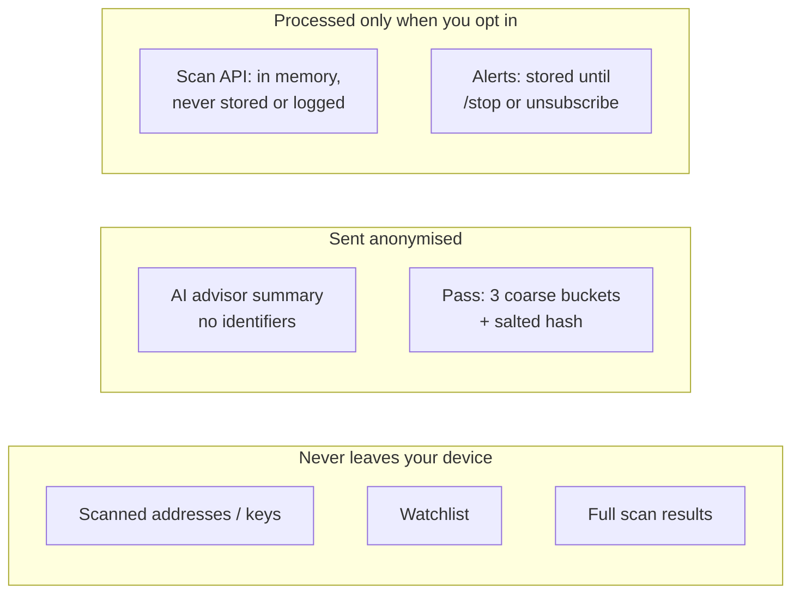

- The scan runs in your browser against public APIs; our servers never see what you scan.
- We **never** ask for seed phrases or private keys.
- Security headers, a clickjacking guard and hardened endpoints are documented in [docs/SECURITY_REVIEW.md](docs/SECURITY_REVIEW.md), [docs/AUDIT.md](docs/AUDIT.md) and [docs/architecture/07-security-privacy.md](docs/architecture/07-security-privacy.md).

---

## On-chain deployments and transactions

**Network:** QoreChain `qorechain-diana` testnet · EVM chain ID `9800` · Explorer: [explore.qore.network](https://explore.qore.network)

| Item | Value |
|---|---|
| **QuantumPass v2** (live) | [`0x4f54b69693458523223504b48fa7cd44657a56df`](https://explore.qore.network/address/0x4f54b69693458523223504b48fa7cd44657a56df) |
| Deploy tx | `0x28f58054f338364083b4f0c9b17751dbdd1df0b27c42974c6d6a553fe7e17e2e` |
| Deployer / attester (immutable) | `0x707B92f6276799f928CCe4D5873f5A2babF85347` · `qor1wpae9a38v7vlj2xvun2cw0669w4ls568zar4w8` |
| Hybrid EVM-window tx | `82CAAC0311B6927598BBD789BFD250CE236DD6DD0B241CB444B511CFE74A1104` |
| Hybrid EVM-window tx (v2) | `C584F991E1A13A89B6967179A0B4F0F2DDF2145A3430A5D9529B1E72CDEC3972` |
| First mint — ML-DSA-87 verified on-chain | `0xb6ac662a1d2618febcc1e20ad337776b1a9af89a37a00d8a63b38ce3e5b4a38d` |
| Live E2E, fresh account — hybrid proof | `926E749DC6C1641ADDF6E87158E836C48084B0528707EC6D2B6849CCE56FE55F` |
| Live E2E, fresh account — `attest()` mint | `0x872179a1355536531bd3f496b297e8d67d6b6ee86813131e38d5d42b739a2f60` |
| Fresh holder | `0x17CBb4cAe0B421714829f64612Cc81EB67848A33` · `qor1zl9mfjhqksshzjpf7erp9nypadncfz3n42hct8` |
| QuantumPass v1 (superseded, self-mint only) | `0x6e48187e3717af4ccf6c9c27716c5d77d7af5c5d` |
| Precompiles | `pqcVerify` `0x…0a01` · `pqcKeyStatus` `0x…0a02` |

Machine-readable record: [`deployments/diana.json`](deployments/diana.json)

---

## Tech stack

| Layer | Technology |
|---|---|
| **Frontend** | Vite · React · TypeScript · hash router (scan input stays in the URL fragment) |
| **Wallets** | wagmi / viem · RainbowKit · `@qorechain/qorex-rainbowkit` · `@qorechain/qorex-types` |
| **QoreChain** | `@qorechain/sdk` (unified account, `EthNativeSigner` hybrid signing, `openEvmWindowMsg`, `buildRegisterPqcKeyMsg`, `signProofOfPossession`, `pqcSign`) · `@qorechain/evm` (`evmWindowStatus`, chain defs) · `@cosmjs/stargate` |
| **Bitcoin crypto** | `@noble/*` + `@scure/*` — key derivation, script hashing, BIP-32/84/86 |
| **Smart contracts** | Solidity 0.8.28 · Foundry · ERC-5192 · QoreChain PQC precompiles |
| **AI** | Google Gemini API (`gemini-3.5-flash`, REST, JSON-schema structured output, key rotation) · zod |
| **Backend** | Vercel serverless functions (`/api/advise`, `/api/ask`, `/api/attest`, `/api/v1/scan`, `/api/alerts`) |
| **Data** | mempool.space / blockstream Esplora · 7 public EVM RPCs · QoreChain REST · CoinGecko |
| **Alerts** | Telegram Bot API ([@ShorsReachBot](https://t.me/ShorsReachBot)) |
| **Quality** | Vitest · Foundry (fuzz) · E2E smoke + real-browser workflow runs via Edge/Chrome · GitHub Actions CI |

---

## Repository layout

```
Shors-Reach/
├── app/                      Vite + React dApp (create-qorechain-dapp viem-wagmi template)
│   ├── src/
│   │   ├── scan/             Scan engine: BTC / EVM / QoreChain scanners, scoring, reasons
│   │   ├── pass/             Quantum Pass: QoreX bridge, proof builder, relayer client
│   │   ├── pages/            Home · Scan · Plan · Pass · Watch · Dashboard · Developers · Methodology · Embed
│   │   ├── alerts/           Watchlist diffing + alert handlers
│   │   └── lib/              Router, formatting, helpers
│   ├── api/                  Vercel functions: advise · ask · attest · alerts · v1/scan
│   └── server/               Server-side attest logic (bundled to api/attest.js)
├── contracts/                Foundry project (create-qorechain-dapp foundry template)
│   ├── src/QuantumPass.sol   Soulbound pass with on-chain ML-DSA-87 verification
│   └── test/                 18 tests incl. fuzz suites and attack cases
├── deployments/diana.json    Addresses and tx hashes on qorechain-diana
├── docs/                     Research, idea, architecture, tracks, reports, security
├── AI_USAGE.md               How AI built the project and runs inside it
└── .github/workflows/ci.yml  Typecheck · tests · build · forge
```

---

## Run locally

**Prerequisites:** Node.js 22 (as in CI), npm, [Foundry](https://book.getfoundry.sh/getting-started/installation) (for contracts).

```sh
# 1. App — scan, plan (rule-based) and dashboard work with no keys
cd app
npm install
npm run dev                      # http://localhost:5173

# 2. Contracts
cd ../contracts
npm install
npm run forge-std
forge test
```

**Optional environment** — `app/.env` (gitignored):

| Variable | Purpose |
|---|---|
| `GEMINI_API_KEYS` | Comma-separated Gemini keys for the AI plan and Q&A (rotated) |
| `ADVISOR_MODEL` | Override the model (default `gemini-3.5-flash`) |
| `QORE_ATTESTER_MNEMONIC` | Testnet mnemonic for `/api/attest` |

**Useful scripts** (in `app/`)

| Command | What it does |
|---|---|
| `npm test` | Unit + integration tests (Vitest) |
| `npm run scan:live -- <input>` | Live scan from the CLI: table + headline |
| `npm run build && npm run preview` then `npm run e2e` | E2E smoke via your installed Edge/Chrome |
| `npm run workflows -- https://shors-reach.vercel.app` | 5 real-browser personas against live chains + AI → [report](docs/reports/workflows-production.md) |
| `npm run benchmark` | Accuracy benchmark vs other quantum-exposure tools → [docs/BENCHMARK.md](docs/BENCHMARK.md) |
| `npm run build:api` | Re-bundle `api/attest.js` after editing `server/attest.ts` (Vercel can't load @cosmjs's CJS→ESM chain unbundled) |

---

## Testing and quality

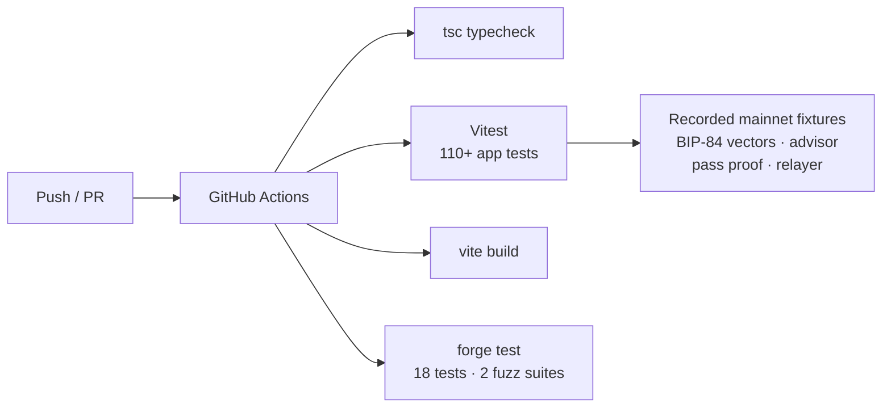

- **App:** 110+ tests — scan engine on recorded mainnet fixtures (incl. BIP-84 test vectors), evidence invariant, advisor validation and leak filters, pass proof and relayer, alerts.
- **Contracts:** 18 Foundry tests including 2 fuzz suites and attack cases (replayed proof, double mint, tampered fields, signature from another key, unregistered PQ key, inactive precompiles, non-attester caller).
- **Production workflow report:** 35/35 checks passing — [docs/reports/workflows-production.md](docs/reports/workflows-production.md).
- **Security:** [docs/SECURITY_REVIEW.md](docs/SECURITY_REVIEW.md) · [docs/AUDIT.md](docs/AUDIT.md).

---

## Scan API and widget

```sh
curl -X POST https://shors-reach.vercel.app/api/v1/scan \
  -H "content-type: application/json" \
  -d '{"input":"0xd8dA6BF26964aF9D7eEd9e03E53415D37aA96045"}'
```

Inputs are processed in memory and never stored or logged. Full request/response schema, reason codes, the two-line `<script>` widget and a live playground: **[shors-reach.vercel.app/#/developers](https://shors-reach.vercel.app/#/developers)**.

---

## Documentation index

| Area | Documents |
|---|---|
| **Idea** | [Problem](docs/idea/01-problem.md) · [Solution](docs/idea/02-solution.md) · [Why this idea](docs/idea/03-why-this-idea.md) · [User flows](docs/idea/04-user-flows.md) |
| **Research** | [Hackathon & QoreChain](docs/research/01-hackathon-and-qorechain.md) · [Competition analysis](docs/research/02-competition-analysis.md) · [Quantum threat research](docs/research/03-quantum-threat-research.md) |
| **Architecture** | [Overview](docs/architecture/01-overview.md) · [Scan engine](docs/architecture/02-scan-engine.md) · [Contracts](docs/architecture/03-contracts.md) · [QoreChain integration](docs/architecture/04-qorechain-integration.md) · [Frontend](docs/architecture/05-frontend.md) · [AI advisor](docs/architecture/06-ai-advisor.md) · [Security & privacy](docs/architecture/07-security-privacy.md) · [Repo & tooling](docs/architecture/08-repo-and-tooling.md) · [Spikes](docs/architecture/spikes.md) |
| **Tracks** | [Quantum Pass main track](docs/tracks/01-quantum-pass-main-track.md) · [Side awards](docs/tracks/02-side-awards.md) · [Submission checklist](docs/tracks/03-submission-checklist.md) |
| **Reports** | [Production workflows](docs/reports/workflows-production.md) · [Workflows](docs/reports/workflows.md) · [Benchmark accuracy](docs/reports/benchmark-accuracy.md) · [Benchmark](docs/BENCHMARK.md) |
| **Security** | [Security review](docs/SECURITY_REVIEW.md) · [Audit](docs/AUDIT.md) |
| **Build process** | [AI_USAGE.md](AI_USAGE.md) · [How the prompts work](docs/prompts/00-how-to-use.md) · [Progress log](docs/prompts/PROGRESS.md) · [Backlog](docs/prompts/BACKLOG.md) |
| **Submission** | [Project page](docs/PROJECT_PAGE.md) · [Video script](docs/VIDEO_SCRIPT.md) · [Social](docs/SOCIAL.md) · [Telegram bot](docs/brand/TELEGRAM_BOT.md) · [Cover](docs/cover.png) |

---

## All links

| What | Link |
|---|---|
| Hackathon project page | https://build.qorechain.io/p/shor-s-reach |
| Live demo | https://shors-reach.vercel.app |
| Demo video | https://youtu.be/4W-PkwzndHk |
| GitHub repository | https://github.com/rohan911438/Shors-Reach |
| CI | https://github.com/rohan911438/Shors-Reach/actions/workflows/ci.yml |
| QuantumPass contract | https://explore.qore.network/address/0x4f54b69693458523223504b48fa7cd44657a56df |
| Quantum Pass page | https://shors-reach.vercel.app/#/pass |
| Public dashboard | https://shors-reach.vercel.app/#/dashboard |
| Developers / Scan API | https://shors-reach.vercel.app/#/developers |
| Methodology & limits | https://shors-reach.vercel.app/#/methodology |
| Telegram alerts bot | https://t.me/ShorsReachBot |
| QoreChain explorer | https://explore.qore.network |

---

## Licence

MIT — see [LICENSE](LICENSE).

<div align="center">

**Built before Q-Day.** 🛡️

</div>
